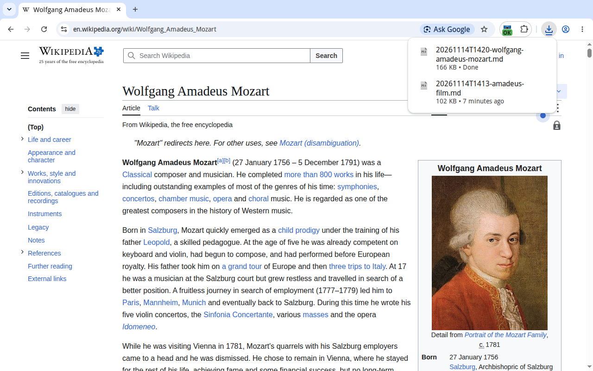

# 

Web Ingest is a Chrome extension that clips the current web page as clean markdown to a folder under your Downloads directory. No application launch, no cloud round-trip, no companion process — the markdown lands on disk through Chrome's own download mechanism.



## What it does (and doesn't)

**Does:**
- One-click clip of an article-shaped page → clean markdown on disk
- YAML frontmatter with title, source URL, and timestamp
- Configurable subdirectory under Downloads
- Optional comment dialog before each clip (off by default)

**Doesn't (yet):**
- Selection-only clipping (it always extracts the whole article)
- Per-domain extraction tweaks
- Firefox (different download/extension APIs)
- Non-article pages (search results, social feeds, dashboards): Readability gives up and you get an `ERR` badge. Pages that are not http(s), such as `chrome://`, `about:` or `file://`, get a grey `SKIP` badge instead
- Writing outside the Downloads tree — Chrome's `downloads` API only allows paths under your configured Downloads folder

## How it works

```
extension (Chrome) ──chrome.downloads──▶ <Downloads>/web-clips/*.md
```

The extension extracts the article using Mozilla Readability and converts the HTML to markdown using Turndown. It builds the YAML frontmatter and filename with `clip-writer.js`, in the service worker or, when the comment dialog is on, in the popup, encodes the result as a `data:` URL, and hands it to `chrome.downloads.download`. Chrome writes the file to a subdirectory of your Downloads folder.

## Install

### From source

Prerequisites: Google Chrome (or Chromium).

1. **Clone the repo.**

   ```sh
   git clone https://github.com/cornelius/web-ingest.git
   ```

2. **Load the extension unpacked.**
   - Open `chrome://extensions`, enable *Developer mode* (top-right toggle).
   - Click *Load unpacked* and select the `extension/` folder.

## Usage

Open any article, click the *Web Ingest* toolbar icon. A green `OK` badge appears for ~3 seconds when the file has been written; a red `ERR` badge means something went wrong (open the service-worker console at `chrome://extensions` for details).

Files are named `YYYYMMDDTHHmm-<title-slug>.md` (ISO 8601 basic format). If two clips collide on the same filename, Chrome appends `(1)`, `(2)`, etc.

The start of a clip of the Wikipedia article on Mozart, `20261114T1421-wolfgang-amadeus-mozart.md` (links shortened):

```markdown
---
title: "Wolfgang Amadeus Mozart"
url: "https://en.wikipedia.org/wiki/Wolfgang_Amadeus_Mozart"
clipped_at: "2026-11-14T13:21:59.517Z"
comment: "Great musician."
---

Wolfgang Amadeus Mozart

[...]

**Wolfgang Amadeus Mozart** (27 January 1756 – 5 December 1791) was a [Classical](https://en.wikipedia.org/wiki/Classical_period_\(music\) "Classical period (music)") composer and musician.
```

### Adding a comment

The default flow is silent — click the icon, get the file. If you'd rather jot a note alongside each clip, open the options page and enable *Ask for a comment when clipping*. Once on, clicking the toolbar icon opens a small popup with a title preview and a textarea; type a note (or leave it empty), then *Save* (or `Ctrl/Cmd+Enter`). The comment is stored as a `comment:` field in the YAML frontmatter; an empty comment is omitted. Press `Esc` or *Cancel* to skip the clip.

## Configuration

| Knob | Default | Where |
|---|---|---|
| Subdirectory under Downloads | `web-clips` | extension options page (`chrome.storage.sync`) |
| Ask for a comment | off | extension options page (`chrome.storage.sync`) |

To open the options page: `chrome://extensions` → *Web Ingest* → *Details* → *Extension options*. In *Subdirectory under Downloads*, forward slashes nest further (`notes/web` writes to `<Downloads>/notes/web/`); leave the field empty to write directly into Downloads.

The actual Downloads location is whatever Chrome is configured to use (`chrome://settings/downloads`).

## Troubleshooting

- **Red `ERR` badge:** hover over the toolbar icon to see the reason. For more detail, open `chrome://extensions`, find *Web Ingest*, click *service worker* and check the console.
- **Each clip shows a download notification:** Chrome surfaces every download in its tray. There's no per-extension way to suppress this in MV3; turning off the tray globally in `chrome://settings` mutes it for all downloads, not just clips.
- **Pages that are not http(s)** (`chrome://`, `about:`, `file://`): the extension does not clip them; you get a grey `SKIP` badge.

## Repo layout

```
extension/        — Chrome MV3 extension
  manifest.json
  background.js   — service worker; silent-clip path + popup toggle
  clip.js         — injected into the page; runs Readability + Turndown
  clip-writer.js  — shared slugify/frontmatter/download logic
  popup.{html,js} — comment dialog (shown when the option is on)
  options.{html,js} — options page: subdirectory + comment toggle
  lib/            — vendored Readability.js (Apache 2.0) and Turndown (MIT)
  icons/          — toolbar and store icons (pixel-art whale)
tests/            — node:test unit tests for clip-writer (`make test`)
scripts/package.sh — builds the store upload zip (`make package`)
store-assets/     — store listing tiles and screenshots, README banner
ARCHITECTURE.md   — wire format, frontmatter schema, design notes
PRIVACY.md        — privacy policy linked from the store listings
EXTENSION-PUBLISHING.md — store listing content and submission checklist
CHROMEWEBSTORE.md — pointer to EXTENSION-PUBLISHING.md
```

## Privacy

The extension collects nothing and makes no network requests. See the [privacy policy](PRIVACY.md).

## License

Code in this repo: MIT (see `LICENSE`). Vendored libraries retain their own licenses (see `extension/lib/LICENSES.md`).
